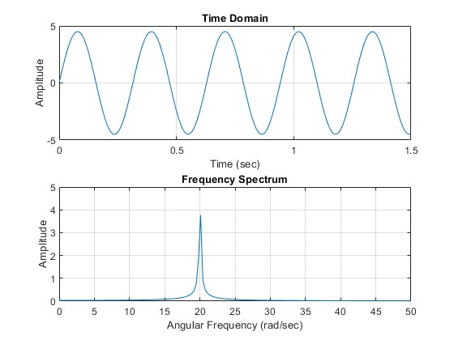
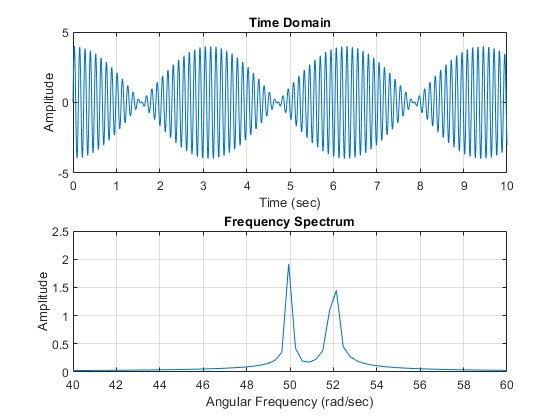
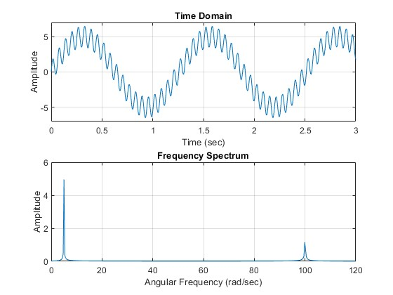
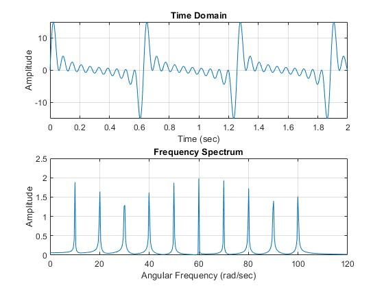
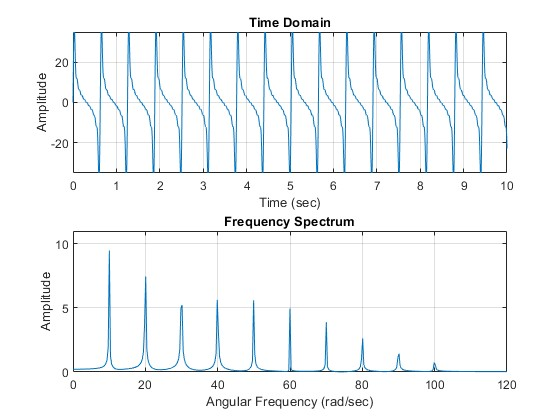
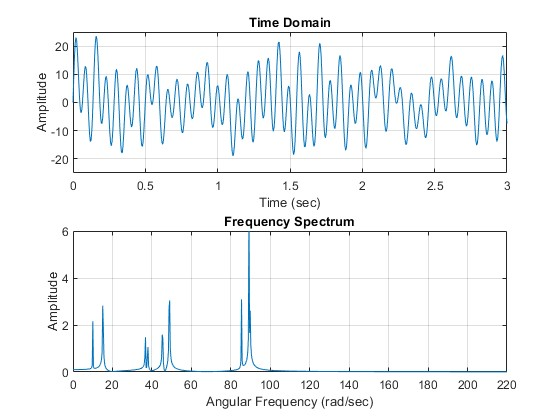

# MATLAB Signal Analysis: Harmonic Superposition & FFT

This repository contains MATLAB scripts and spectral analysis results investigating the time-domain superposition of harmonic signals and their frequency-domain representations using the Fast Fourier Transform (FFT). 

Developed as part of the Mechanical Engineering curriculum at the **Faculty of Engineering, Alexandria University** under the supervision of **Dr. Bassiony** and **Dr. Mekhemer**.

---

## Overview & Methodology

Each script generates a composite harmonic signal in the continuous time domain and computes its normalized frequency spectrum:
* **Time Step (dt):** `0.005 s` (Sampling Frequency `fs = 200 Hz`)
* **Total Duration (T):** `20 s` (`N = 4001` samples), providing high frequency resolution to separate closely spaced harmonics without aliasing.
* **Amplitude Normalization:** The raw FFT magnitude is scaled by `2 / N` to accurately reflect the physical amplitudes of the constituent sine waves.
* **Frequency Axis Conversion:** Frequencies are converted from Hz to angular frequency (`rad/sec`) via `w_axis = 2 * pi * f`.

### Summary of Analyzed Cases

| Case | Script | Harmonics | Amplitudes | Angular Frequencies (rad/sec) | Key Phenomenon |
| :--- | :--- | :---: | :--- | :--- | :--- |
| **Case 1** | `case1.m` | 2 | `A1 = 3`, `A2 = 1.5` | `w1 = 20`, `w2 = 20` | Pure sinusoidal addition |
| **Case 2** | `case2.m` | 2 | `A1 = 2`, `A2 = 2` | `w1 = 50`, `w2 = 52` | Beat phenomenon (w1 ≈ w2) |
| **Case 3** | `case3.m` | 2 | `A1 = 5`, `A2 = 1.5` | `w1 = 5`, `w2 = 100` | High-frequency ripple on carrier (w2 ≫ w1) |
| **Case 4** | `case4.m` | 10 | Equal (`A = 2`) | `10, 20, 30, ..., 100` | Complex periodic waveform (comb spectrum) |
| **Case 5** | `case5.m` | 10 | Decreasing (`10, 9, ..., 1`) | `10, 20, 30, ..., 100` | Smoothed periodic waveform (staircase spectrum) |
| **Case 6** | `case6.m` | 10 | Random (`1` to `5`) | Random (`10` to `200`) | Chaotic, aperiodic waveform |

---

## Case Studies & Results

### 1. Two Harmonics with Different Amplitudes and Same Frequency
**Description:** The resultant is a single harmonic wave. Because the frequencies are identical (`20 rad/sec`), the two signals simply add together to form one pure sine wave with a combined amplitude of `4.5`. The frequency spectrum shows a single, isolated peak at that exact frequency.
* **Code:** [`case1.m`](case1.m)



---

### 2. Two Harmonics with Equal Amplitudes and Very Close Frequencies (ω1 ≈ ω2)
**Description:** This combination (`50 rad/sec` and `52 rad/sec`) produces the **beat phenomenon**. The slight difference in frequencies causes the signals to continuously shift in and out of phase, alternating between constructive and destructive interference. This creates a fast carrier wave trapped inside a slowly pulsating amplitude envelope. The frequency spectrum shows two distinct, closely spaced peaks.
* **Code:** [`case2.m`](case2.m)



---

### 3. Two Harmonics with Different Amplitudes and Widely Separated Frequencies (ω1 ≫ ω2)
**Description:** The resultant signal consists of a fast, small-amplitude ripple (`100 rad/sec`, `A = 1.5`) superimposed on top of a slow, dominant wave (`5 rad/sec`, `A = 5`). Because the frequencies are vastly different, they do not blend into a beat pattern. The frequency spectrum displays two completely separate peaks located far apart on the axis.
* **Code:** [`case3.m`](case3.m)



---

### 4. Ten Harmonics with Equal Amplitudes and Structured Frequencies
**Description:** The addition of ten evenly spaced harmonics (`ω = 10, 20, ..., 100 rad/sec`) with equal amplitude (`A = 2`) creates a complex, strictly periodic non-sinusoidal waveform. Because all amplitudes are equal, the high-frequency components contribute just as much energy as the low-frequency ones. The frequency spectrum displays ten uniform peaks spaced exactly `10 rad/sec` apart.
* **Code:** [`case4.m`](case4.m)



---

### 5. Ten Harmonics with Different Amplitudes and Structured Frequencies
**Description:** While the frequencies (`ω = 10, 20, ..., 100 rad/sec`) are identical to Case 4, the linearly decreasing amplitudes (`A = 10` down to `1`) mean the higher frequencies carry progressively less energy. This results in a visually smoother periodic waveform in the time domain. The frequency spectrum shows ten evenly spaced peaks forming a linear downward staircase pattern.
* **Code:** [`case5.m`](case5.m)



---

### 6. Ten Harmonics with Different Amplitudes and Randomly Chosen Frequencies
**Description:** The resultant is a chaotic, aperiodic signal generated using a fixed random seed (`rng(1)`) for reproducibility. Because the frequencies (`10` to `200 rad/sec`) are chosen randomly, they lack a common fundamental period and do not align to form a repeating pattern. The frequency spectrum reveals ten scattered peaks of varying heights (`1` to `5`) placed irregularly along the frequency axis.
* **Code:** [`case6.m`](case6.m)



---

## How to Run

1. Clone this repository:
   ```bash
   git clone [https://github.com/AhmedBsher/MATLAB-Signal-Analysis.git](https://github.com/AhmedBsher/MATLAB-Signal-Analysis.git)
